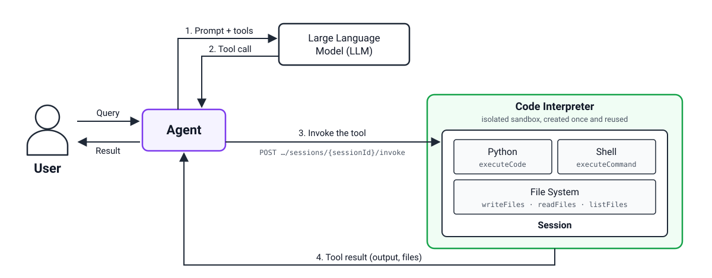

# Built-in Tools

Built-in Tools let your agent **run code** and **drive a real browser** inside a sandbox that is isolated per session — without provisioning any infrastructure, image, or container of your own.

Two tools are available:

| Tool | Use it to |
|---|---|
| **Code Interpreter** | Run Python and shell commands, read/write files, run background processes — each session in its own microVM |
| **Browser** | Drive a real Chrome (via CDP), watch the screen live over noVNC, and replay session recordings |

Both tools integrate over **MCP** — your agent connects to an MCP endpoint provisioned by GreenNode, and the tools appear like any other MCP tools.


Built-in Tools is currently being rolled out by **whitelist**. If your account is not yet enabled, contact [support@greennode.ai](mailto:support@greennode.ai), hotline **19001549**, or the [Support Center](https://helpdesk.greennode.ai/portal/vi/home) to be added to the list.


---

## Architecture

Each of your sessions runs inside its own microVM with a dedicated kernel, claimed from a pre-warmed VM pool, so creating a session takes only a few seconds. Both tools share the same sandbox foundation — they differ in the product layer on top:

<figure><figcaption>
Code Interpreter — the agent calls tools over MCP, code runs in an isolated sandbox microVM
</figcaption></figure>

<figure><figcaption>
Browser — the agent drives Chromium inside a sandbox microVM over CDP
</figcaption></figure>

Main layers:

- **Built-in Tools** — the product layer: manages resources you own (each Code Interpreter / Browser has an id, name, status), plus quotas, authentication, and lifecycle. The sandbox runtime underneath stays hidden — its id and URL are never exposed.
- **AgentBase Runtime + OpenSandbox** — the platform layer: creates and keeps VMs warm (Pool), assigns one VM per new session, and reclaims it when the session ends.
- **Dedicated vKS node group** — sandbox workloads are separated onto a dedicated node group on vKS with **nested virtualization** enabled and the `nested-virt` taint so regular pods cannot take those nodes. Each sandbox pod runs through RuntimeClass `kata-clh` (Kata Containers + Cloud Hypervisor).

### Why one microVM per session?

Agents need to run code and drive browsers exactly as you ask — and the platform must guarantee that every session operates **fully independently**, even when code hits errors or contains vulnerabilities. A regular Kubernetes pod shares the host kernel — one kernel vulnerability can spread to other pods on the same node. With the sandbox, each session gets its own kernel, separated by a hardware-enforced virtualization boundary: an incident in one session stays inside that session. When the session ends, the VM is destroyed and all state inside it disappears.

---

## Connecting your agent

Each tool has its own MCP endpoint (streamable HTTP) behind the AgentBase Gateway. Connect using any MCP client (Claude Code, Cursor, or an MCP SDK):

| Tool | MCP endpoint |
|---|---|
| Code Interpreter | `https://gw-greennode-builtin-tools-110718.agentbase-gateway.aiplatform.vngcloud.vn/code` |
| Browser | `https://gw-greennode-builtin-tools-110718.agentbase-gateway.aiplatform.vngcloud.vn/browser` |

### Authentication

The endpoint is an **OAuth resource server** — your client drives the whole login flow, so you never create or paste tokens by hand:

1. The client calls the endpoint without a token → gets `401` with a `WWW-Authenticate` header pointing to the authorization server.
2. The client registers itself (**Dynamic Client Registration**) and opens the browser at the GreenNode Portal login URL.
3. After sign-in, the client keeps the access token and **refreshes it automatically** — no re-login every session.

Tokens from a **Root user, IAM user, or Service Account** all work — all three issue the same kind of access token. If your agent runs headless (no browser available), attach the access token directly in your client's configuration.

Each MCP connection is pinned to a specific resource via a header — `x-code-interpreter-id` for Code Interpreter, `x-browser-id` for Browser — see each tool's page for detailed connection instructions.

---

## Getting Started with Built-in Tools

| I want to... | Go to |
|---|---|
| Let my agent run Python / shell | [Use Code Interpreter](use-code-interpreter.md) |
| Let my agent drive a browser, watch live, and replay recordings | [Use Browser](use-browser.md) |
| Understand the isolation, security model, and limits | [Sandbox: security and limits](sandbox-security-and-limits.md) |
