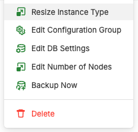
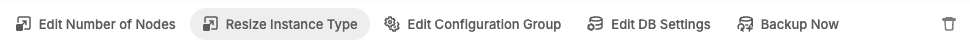
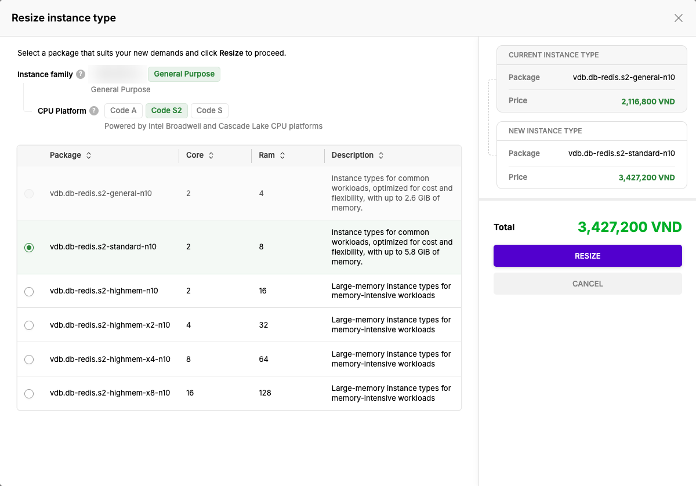
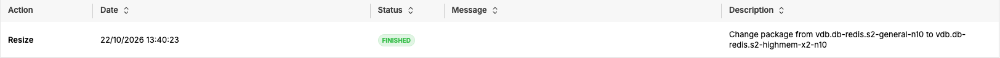
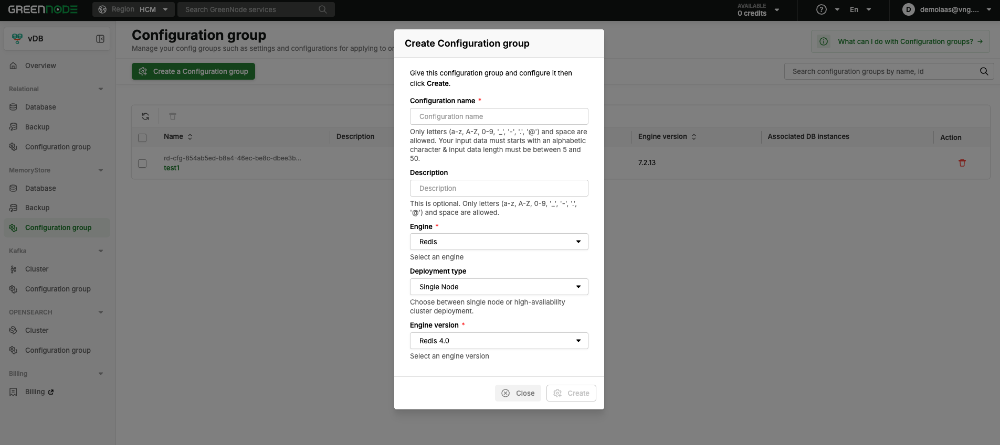
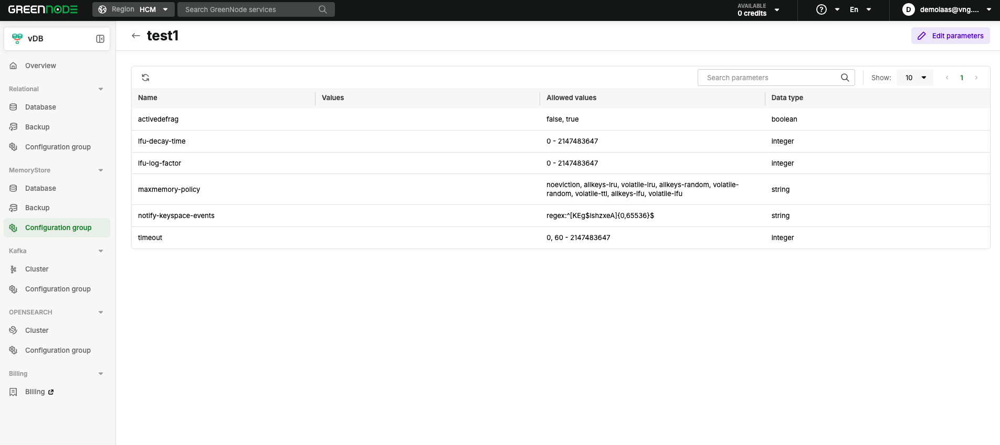
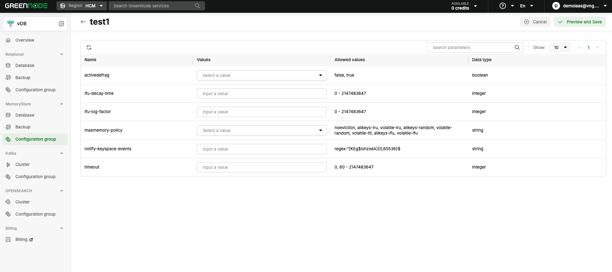

# Manage a Redis Cluster

After creating a Redis Cluster, you can manage its topology, change the number of replicas, change the instance type, trigger manual backups, and delete the cluster directly from the cluster detail page.

***

## Prerequisites

* At least 1 Redis Cluster in **Available** status exists.
* Database management permissions on the vDB account.

***

## Filter the Database List

The Database list page supports quick filtering by deployment type using tabs at the top of the page:

| Tab               | Shows                                   |
| ----------------- | --------------------------------------- |
| **All Databases** | All databases (Single-node and Cluster) |
| **Single-node**   | Single-node databases only              |
| **Cluster**       | Cluster databases only                  |

A count badge is shown next to each tab name. The quick filter works together with search: when on the **Cluster** tab, search results return only Cluster databases.

***

## View Topology

The **Topology** tab on the cluster detail page displays the full master–replica structure of the cluster.

.png>)

**To view Topology:**

1. Go to the Redis Cluster detail page.
2. Select the **Topology** tab.

This tab shows:

* **Master node:** Green database icon labeled "Master".
* **Replica nodes:** Icons displayed below, showing up to 2 replicas; the rest are grouped as "+N".
* **Summary:** Number of Masters, Replicas, and total nodes.

***

## Change Number of Replicas (Edit Nodes)

You can scale up or scale down the number of Replicas after cluster creation with no downtime.

.png>)

**To change the number of Replicas:**

1. On the cluster detail page, select the **Topology** tab.
2. Click **Edit nodes**.
3. In the **Edit Cluster** dialog, select a new **Number of nodes** — the UI shows only two options: current−1 or current+1.
4. Review the **Cost Summary** panel on the right:
   * **CURRENT CONFIGURATION:** Current setup and price.
   * **NEW CONFIGURATION:** New setup and price.
   * **Total:** Cost difference (green = increase, red = decrease).
5. Click **SAVE** to apply.


Each edit allows only **±1 node** at a time. To reach a target node count, save and repeat the operation. This ensures each sync completes before the next step, preventing replication errors.


***

## Change Instance Type (Resize Instance Type)

You can increase or decrease the instance type (CPU/RAM) of a cluster directly on the portal, without creating a new cluster, moving data, or changing the endpoint in your application.


Resize Instance Type for Redis Cluster is currently available in the **HAN** region only.


* Resizing applies to the **whole cluster**: all nodes switch to the same instance type. You cannot resize individual nodes.
* Works in both directions: up to a larger package or down to a smaller one.
* A cluster can be resized only while it is in **ACTIVE** status.

**To change the Instance Type:**

1. Open the **Resize instance type** dialog in one of two ways:
   * On the Database list page, click the **Action (⋮)** icon of the cluster, then select **Resize Instance Type**.

     
   * On the cluster detail page, click the **Resize Instance Type** button in the header.

     
2. In the dialog, select an **Instance family** and a **CPU Platform**, then select a new package in the table. The **Description** column shows how much memory each package provides for your data.
3. Review the cost on the right side of the dialog:
   * **CURRENT INSTANCE TYPE:** package and price of the instance type in use.
   * **NEW INSTANCE TYPE:** package and price of the selected package.
   * **Total:** equal to the price of the new package.

   Prices shown are the monthly price of one node multiplied by the number of nodes in the cluster.
4. Click **RESIZE** to apply, or **CANCEL** to close the dialog without changes.

Some packages in the table are greyed out and cannot be selected:

* The package currently in use.
* Smaller packages that cannot hold the amount of data the cluster currently stores.

When increasing the instance type, the system checks your quota for the additional CPU/RAM multiplied by the number of nodes. If the quota is insufficient, the request is rejected with a message and the cluster keeps its current configuration. No quota check is performed when decreasing the instance type.

### During and after resizing

* The cluster switches to **BUILDING** status. During this time, all actions in the Action menu and the header (including Resize Instance Type and Delete) are greyed out and unavailable.
* While nodes restart one after another, writes to Redis may fail for a short moment each time the master switches. The connection endpoint stays the same.
* When the resize completes, the cluster returns to **ACTIVE** and the Instance type field shows the new package. All data is preserved.
* The new package's price applies from the moment the resize succeeds. The Free Backup size also changes with the new package.
* The **History** tab records the operation with Action **Resize** and Description "Change package from" followed by the old and new package names. Status changes from **IN-PROGRESS** to **FINISHED**.

If the resize fails, the system automatically reverts the cluster to the previous instance type and **ACTIVE** status; data is not affected and the price does not change. The Resize row in the History tab changes to **FAILED**, with the error shown in the **Message** column.

***

## Manual Backup (Back up now)

The **Back up now** button is located directly in the cluster detail page header, allowing you to create a Full Snapshot immediately without navigating into submenus.

**To create a Manual Backup:**

1. On the cluster detail page header, click **Back up now**.
2. Confirm in the dialog: _"This will create a full snapshot of \[cluster name]"_.
3. Click **Back up now**.

The system will show a _"Manual backup is being created"_ notification and the new backup will appear in the **Backup** tab with **In Progress** status.

.png>)


* The **Back up now** button is disabled when a backup job is already running (Auto or Manual). A tooltip will display: _"A backup job is currently in progress"_.
* When the account quota is exceeded, the system returns a `QuotaExceeded` error and does not auto-retry.
* Only **Full Snapshot** is supported — Incremental manual backup is not available.


***

## View Backup Information

The **Backup** tab on the cluster detail page lets you monitor backup status and history.

**To view Backup information:**

1. On the cluster detail page, select the **Backup** tab.

.png>)

This tab shows:

* **Backup Information:** Description, Created Date, Latest Record, Backup Size, Backup Policy, Backup Location.
* **Backup List:** List of backup records with columns: Backup DB Point ID, Backup Size (GB), Backup Type, Schedule Type, Backup Location, Backup Point, Status, Action.

Click **View full backup details →** to open the detailed backup page for this cluster in Backup Center (opens in a new tab).

***

## Manage Backups in Backup Center

The vDB **Backup** page (menu: Memory Store > Backup) shows a summary of your backups. For full management operations (Restore, Delete, Policy management), you need to go to Backup Center.

| State               | Action                                                                     |
| ------------------- | -------------------------------------------------------------------------- |
| No backups yet      | Click **Create a Backup** to be redirected to Backup Center to create one. |
| Has backups         | Click **Go to vBackup** to open Backup Center (filtered by Vault vDB).     |
| Click a backup name | Opens the backup detail page in Backup Center (new tab).                   |

***

## Configure Parameters (Configuration Group)

A Redis Cluster applies parameter configuration through a **DB Configuration Group**: you create a group, attach it to the cluster, and edit parameters directly on the portal instead of manually editing configuration files.

### View and create a Configuration Group

1. Open the **Configuration group** page on the vDB portal.
2. Search for a group by name or ID, or create a new group with **Create a Configuration group**.

When creating a group for a Redis Cluster: enter a **Configuration name** and description, select **Engine** Redis, **Deployment type** Cluster, then choose the **Engine version** that matches your cluster.

<figure><figcaption>
Create Configuration group dialog — select Deployment type Cluster when creating a group for a Redis Cluster
</figcaption></figure>

### Attach a group to a Redis Cluster

1. Open the Redis Cluster detail page and select **Edit Configuration Group** on the header. This action is also available in the cluster's Action Menu (⋮) on the Database list.
2. In the dialog, open the **DB configuration group** dropdown and select the group to attach. The list only shows groups of the same engine as the cluster; click the refresh icon if a newly created group does not appear.
3. Click **Save** to update the group for the cluster.

### Edit parameters

Open the Configuration Group attached to the cluster — the detail page shows the parameter table with **Name**, **Values**, **Allowed values**, and **Data type**.

Click **Edit parameters** to switch to edit mode, change parameters within their **Allowed values**, then click **Preview and Save**.

In the **Preview changes and apply** dialog: review the changes in the **Current value** / **New value** table, tick the checkbox to confirm that editing parameters will affect the attached databases, then click **Apply**.


**Behavior when removing a parameter from the Configuration Group**: For a Redis Cluster, when you remove a parameter from the Configuration Group attached to the cluster, the parameter **keeps its current value** and does **not** revert to the Database Engine's default value. This differs from a Redis Single node, where a removed parameter reverts to the Database Engine's default value.

Each time you edit, you can change one or more parameters. Parameters that you do not change on the portal keep their current values.


***

## Delete a Redis Cluster


Deleting a cluster **cannot be undone**. All data will be permanently deleted.


**To delete a cluster:**

1. On the cluster detail page, click the **More Actions (⋮)** icon.
2. Select **Delete**.
3. In the confirmation dialog:
   * **(Optional)** Check **Create final backup?** to take a final snapshot before deletion (only available if the cluster still has a Backup Database in vBackup).
   * Check **I acknowledge...** to confirm you understand backup access will be lost.
   * Type **delete** in the confirmation input field.
4. Click the red **Delete** button to complete.


If the cluster's Backup Database has already been removed from vBackup, the **Create final backup?** checkbox will be disabled and the system will display: _"No backup database found. Final backup is unavailable."_


***

## Action Menu

From the Database list page, click the **Action (⋮)** icon next to a Redis Cluster for quick actions:

| Action                       | Description                                                  |
| ---------------------------- | ------------------------------------------------------------ |
| **Resize Instance Type**     | Increase or decrease the cluster's instance type (CPU/RAM). Currently available in the HAN region only. |
| **Edit configuration group** | Edit Redis configuration parameters.                         |
| **Edit DB settings**         | Edit the cluster name, backup policy, and database settings. |
| **Delete**                   | Delete the cluster (with confirmation dialog).               |

***

## Next Steps

* [View limitations and constraints for Redis Cluster](https://github.com/vngcloud/docs/blob/main/English/vdb/memorystore-database-service-mds/redis-cluster/redis-cluster-limitations.md)
* [Understand the architecture and compare with Single-node](./)
