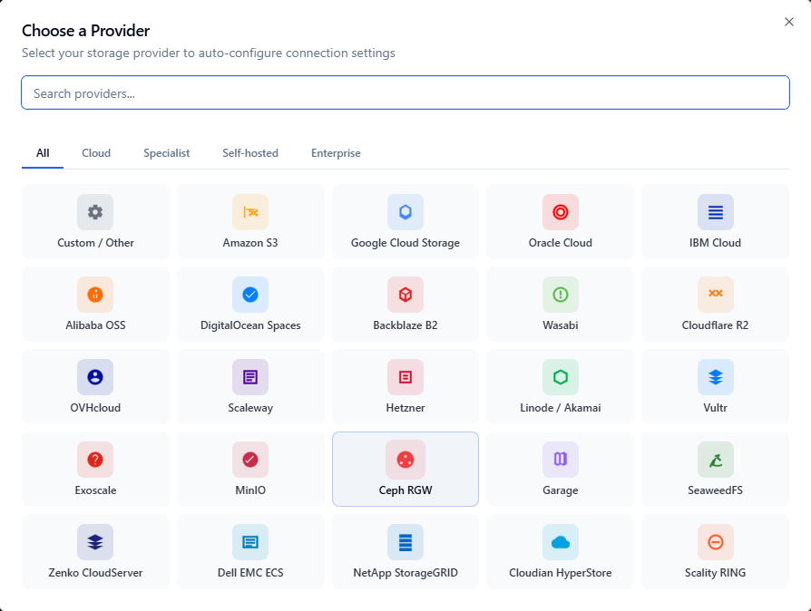
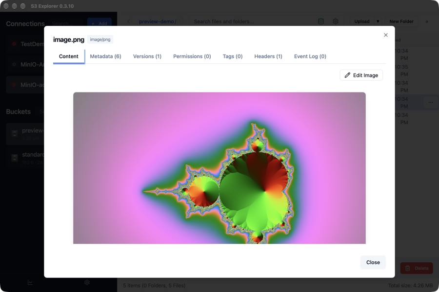

# Integrate S3 Explorer with vStorage

After you have created your project and your S3 key, you can connect S3 Explorer to vStorage:

1. Download S3 Explorer from [s3explorer.accessdevops.com](https://s3explorer.accessdevops.com/) and install it.
2. Open S3 Explorer, select **+ Add** next to **Connections**, then choose **Custom / Other**.

<figure><figcaption></figcaption></figure>

3. Enter the following information:

* **Profile Name:** a name for this connection. Example: Demo\_HCM04
* **Endpoint URL:** `https://hcm04.vstorage.vngcloud.vn` for Region HCM04. vStorage only accepts HTTPS.
* **Region:** leave empty.
* **Access Key** and **Secret Key:** the S3 key pair you created earlier.
* **Force path-style addressing:** select it.

4. Select **Test Connection**, then **Save**. Your buckets appear in the left panel, and you can open, upload, download and preview objects.

<figure><figcaption></figcaption></figure>
