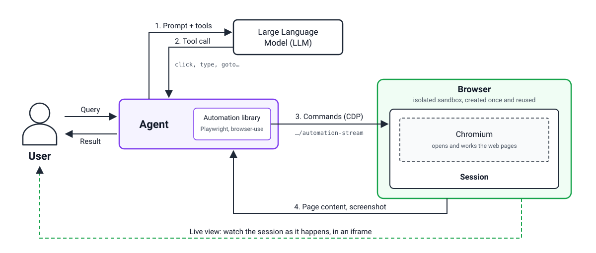

# Built-in Tools

Built-in Tools giúp agent của bạn **chạy code** và **điều khiển trình duyệt thật** trong môi trường sandbox được cô lập theo từng session — mà không cần tự dựng hạ tầng, image hay container.

Hiện có 2 tool:

| Tool | Dùng để |
|---|---|
| **Code Interpreter** | Chạy Python và lệnh shell, đọc/ghi file, chạy tiến trình nền — mỗi session trong một microVM riêng |
| **Browser** | Điều khiển Chrome thật (qua CDP), xem trực tiếp màn hình qua noVNC, lưu bản ghi phiên |

Cả hai tool đều **tích hợp qua MCP** — agent của bạn kết nối vào endpoint MCP do GreenNode cấp, tool xuất hiện như các MCP tool bình thường.


Built-in Tools đang được mở theo từng đợt **whitelist**. Nếu account của bạn chưa được bật, liên hệ [support@greennode.ai](mailto:support@greennode.ai), hotline **19001549**, hoặc [Trung tâm hỗ trợ](https://helpdesk.greennode.ai/portal/vi/home) để được thêm vào danh sách.


---

## Kiến trúc

Mỗi session của bạn chạy trong một microVM riêng có kernel riêng, được cấp từ pool VM làm nóng sẵn (warm pool) nên tạo session chỉ mất vài giây. Hai tool dùng chung một nền sandbox — khác nhau ở lớp sản phẩm bên trên:

<figure><figcaption>
Code Interpreter — agent gọi tool qua MCP, code chạy trong sandbox microVM cô lập
</figcaption></figure>

<figure><figcaption>
Browser — agent điều khiển Chromium trong sandbox microVM qua CDP
</figcaption></figure>

Các tầng chính:

- **Built-in Tools** — lớp sản phẩm: quản lý tài nguyên bạn sở hữu (Code Interpreter / Browser có id, tên, trạng thái), quota, xác thực và vòng đời. Runtime sandbox nằm ẩn bên dưới, không lộ id hay URL ra ngoài.
- **AgentBase Runtime + OpenSandbox** — lớp nền tảng: tạo và giữ sẵn VM (Pool), cấp một VM cho mỗi session mới, thu hồi khi session kết thúc.
- **vKS node group riêng** — workload sandbox được tách sang node group riêng trên vKS, bật **nested virtualization** và gắn taint `nested-virt` để pod thường không chiếm chỗ. Mỗi pod sandbox chạy qua RuntimeClass `kata-clh` (Kata Containers + Cloud Hypervisor).

### Vì sao mỗi session một microVM?

Agent cần chạy code và điều khiển trình duyệt đúng theo yêu cầu của bạn — và nền tảng cần đảm bảo mọi session hoạt động **hoàn toàn độc lập** với nhau, kể cả khi code gặp lỗi hoặc chứa lỗ hổng. Pod thường trên Kubernetes dùng chung kernel host — một lỗ hổng kernel có thể lan sang pod khác trên cùng node. Với sandbox, mỗi session có kernel riêng, ngăn cách bởi ranh giới ảo hoá do phần cứng thực thi: sự cố của session này được giữ nguyên trong đúng session đó. Hết session, VM bị huỷ và mọi trạng thái bên trong biến mất.

---

## Kết nối agent của bạn

Mỗi tool có một endpoint MCP (streamable HTTP) nằm sau AgentBase Gateway. Kết nối bằng bất kỳ MCP client nào (Claude Code, Cursor, hoặc MCP SDK):

| Tool | Endpoint MCP |
|---|---|
| Code Interpreter | `https://gw-greennode-builtin-tools-110718.agentbase-gateway.aiplatform.vngcloud.vn/code` |
| Browser | `https://gw-greennode-builtin-tools-110718.agentbase-gateway.aiplatform.vngcloud.vn/browser` |

### Xác thực

Endpoint là một **OAuth resource server** — client tự điều phối toàn bộ flow đăng nhập, bạn không cần tạo hay dán token thủ công:

1. Client gọi endpoint không kèm token → nhận `401` kèm header `WWW-Authenticate` trỏ tới authorization server.
2. Client tự đăng ký (**Dynamic Client Registration**) và mở trình duyệt tại URL login của GreenNode Portal.
3. Sau khi đăng nhập, client giữ access token và **tự refresh** — không cần đăng nhập lại mỗi session.

Token từ **Root user, IAM user hoặc Service Account** đều dùng được — cả ba đều cấp cùng một loại access token. Nếu agent chạy headless (không mở được trình duyệt), gắn access token trực tiếp vào cấu hình của client.

Mỗi kết nối MCP gắn với một tài nguyên cụ thể qua header — `x-code-interpreter-id` cho Code Interpreter, `x-browser-id` cho Browser — xem hướng dẫn kết nối chi tiết trong trang từng tool.

---

## Bắt đầu với Built-in Tools

| Tôi muốn... | Đi đến |
|---|---|
| Cho agent chạy được Python / shell | [Sử dụng Code Interpreter](su-dung-code-interpreter.md) |
| Cho agent điều khiển trình duyệt, xem live và xem lại bản ghi | [Sử dụng Browser](su-dung-browser.md) |
| Hiểu mô hình cô lập, bảo mật và giới hạn | [Sandbox: bảo mật và giới hạn](sandbox-bao-mat-va-gioi-han.md) |
